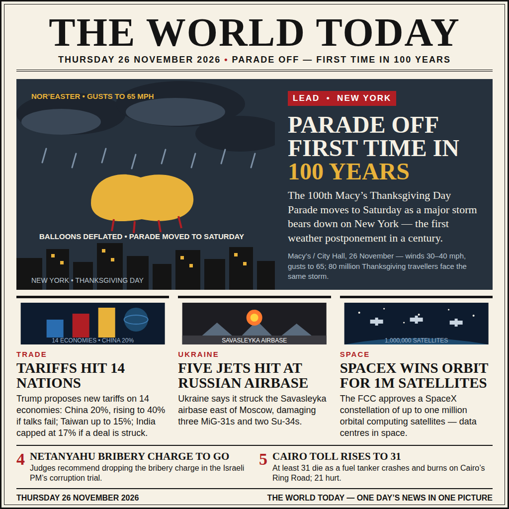

# THE WORLD TODAY — Thursday 26 November 2026

[](https://make.fun/c/news-image-20261126)
[](https://make.fun/c/news-image-20261126)
[](https://make.fun/c/news-image-20261126)

Entry for the make.fun bounty [Sum up 26 November's world news in one image](https://make.fun/c/news-image-20261126).

## The image

A newspaper front page, **THE WORLD TODAY**, dated **THURSDAY 26 NOVEMBER 2026**,
summing up the day's world news in one picture.



## Stories pictured

- **Parade off — first time in 100 years.** The 100th Macy's Thanksgiving Day
  Parade is postponed to Saturday as a nor'easter bears down on New York —
  the first weather postponement in the parade's century of history. Winds
  30–40 mph, gusts to 65; 80 million Thanksgiving travellers face the same
  storm.
- **Tariffs hit 14 nations.** President Trump proposes new tariffs on 14
  economies after a Section 301 probe into factory overcapacity: China 20%,
  rising to 40% if talks fail; Taiwan up to 15%; India capped at 17% if a
  deal is struck. The Nasdaq falls almost 4%.
- **Five jets hit at Russian airbase.** Ukraine says it struck the Savasleyka
  airbase east of Moscow, damaging three MiG-31s and two Su-34 fighter-bombers.
- **SpaceX wins orbit for 1M satellites.** The FCC approves a SpaceX
  constellation of up to one million orbital computing satellites — the first
  go-ahead for data centres in space.
- **Netanyahu bribery charge to go.** Judges recommend dropping the bribery
  charge in the Israeli prime minister's corruption trial.
- **Cairo toll rises to 31.** At least 31 die as a fuel tanker crashes and
  burns on Cairo's Ring Road; 21 are hurt.

The front page was duel-tested against two other layouts built the same morning
(a tariffs-led broadsheet and a dark poster with a 2×2 story grid). The
parade-led broadsheet won: it leads with the day's most recognisable story,
its deflated-balloon-and-storm scene reads at a glance, every story carries
its own drawn visual, and it stays legible at ~300 px wide. The tariffs-led
broadsheet lost on its lead visual (a muddled container ship), and the dark
poster lost on cramped grid art despite carrying seven stories.

## How it runs

`main.ts` (Node 22, standard library only) copies `entry.png` to
`$MAKEFUN_OUTPUT_DIR/entry.png` (default `/output`), creating the directory
if needed. It takes no input and writes the same bytes on every run:

```sh
mkdir -p out && MAKEFUN_OUTPUT_DIR=out node main.ts
```

Deterministic: two runs write byte-identical files (same sha256), and the
image is 1024×1024 at 199,968 bytes, under the 1 MiB cap.

## Sources

- Macy's / New York City Hall, 26 November 2026 — the 100th Macy's
  Thanksgiving Day Parade postponed to Saturday, 28 November, the first
  weather postponement in its 100-year history; nor'easter gusts to 65 mph.
- Reuters world news summary, 26 November 2026 — US proposes new tariffs on
  14 economies; Ukraine strikes Savasleyka airbase, five planes damaged;
  second judge blocks Trump's birthright-citizenship order; dozens of
  countries call on Russia to halt alleged riot-agent use in Ukraine.
- World in Sixty / NEWSZY, 26 November 2026 — FCC approves up to one million
  SpaceX orbital computing satellites; judges recommend dropping the bribery
  charge in Netanyahu's trial; Bank of Korea raises its base rate to 3.25%.
- Associated Press, 26 November 2026 — Cairo Ring Road tanker fire death toll
  rises to 31, with 21 injured.
